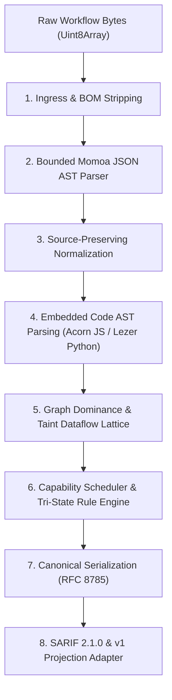

# @hub/scanner-core — The n8n-SecureFlow Scanner Core Engine

> **Workspace package:** private `@hub/scanner-core@0.1.0`; admitted v2 engine identity `secureflow-scanner@2.0.0`. These are distinct from the published CLI package `sfscanner@0.2.1`.  
> **Architecture:** Compiler-Grade Static AST & Dataflow Analysis Engine for n8n Workflows  
> **Licensing:** MIT for this scanner tooling. See the [canonical licensing policy](../../docs/LICENSING.md) for the catalogue dataset terms.

---

## 1. Overview & Architectural Philosophy

`@hub/scanner-core` is the deterministic, compiler-grade security analysis engine powering the n8n-SecureFlow ecosystem. Unlike naive regex scanners or pattern matchers that break on whitespace and line breaks, `@hub/scanner-core` constructs formal **Abstract Syntax Trees (ASTs)** of workflow JSON documents, parses embedded JavaScript and Python scripts, and analyzes whole-graph dataflow lattices.

### Core Guarantees
* **100% Deterministic & Offline:** Zero system clocks, zero network access, zero dynamic imports, and zero random number generation. Repeated scans of the same workflow produce byte-identical SHA-256 results.
* **Safe Static Inspection:** Never executes submitted workflow code, never instantiates n8n instances, and never contacts external networks.
* **Fail-Closed Completeness:** Employs **Strong-Kleene Tri-State Logic** (`TRUE`, `FALSE`, `UNKNOWN`) to ensure ambiguous or incomplete workflows are never falsely graded as "Safe".

---

## 2. Engine Pipeline & Authority Boundary

---

## 3. Deep-Dive Subsystem Architecture

### 3.1 Bounded Momoa JSON AST Parser
* **File:** [`src/source/source-parser.ts`](src/source/source-parser.ts)
* **Technology:** `@humanwhocodes/momoa`
* **Mechanism:** Rather than discarding formatting with native `JSON.parse()`, the parser builds an immutable, frozen AST. Every node, connection, key, and string literal is mapped to exact **byte offsets, line numbers, and column coordinates**.
* **Protections:**
  * Byte-first UTF-8 validation and BOM normalization.
  * Preflight depth inspection enforcing a strict **512-level recursion ceiling**.
  * Detection and rejection of duplicate JSON keys (mitigating JSON parsing differential attacks).

### 3.2 Embedded Script AST Parsers (JavaScript & Python)
* **Files:** [`src/capabilities/`](src/capabilities/) (see [`javascript-security.ts`](src/capabilities/javascript-security.ts) & [`python-security.ts`](src/capabilities/python-security.ts))
* **Technology:** `acorn` (JavaScript / TypeScript) & `@lezer/python` (Python)
* **Mechanism:** Function and Code nodes are inspected through lexical tokenization and AST construction.
* **Detection Vectors:**
  * Dynamic code execution: `eval()`, `Function()`, `setTimeout()`, `exec()`, `vm.runInContext()`.
  * Node.js child process spawning and shell execution: `require('child_process')`, `spawn()`, `execSync()`.
  * Multi-line string concatenation and obfuscated payload assembly.

### 3.3 Graph Dataflow & Taint Propagation Lattice
* **Files:** [`src/workflow-v2/`](src/workflow-v2/)
* **Theory:** Workflow connections are modeled as a directed graph $G = (V, E)$.
* **Graph Algorithms:**
  * **Tarjan's Strongly Connected Components (SCC):** Identifies cycles and infinite loop topologies.
  * **Dominance & Reachability Analysis:** Computes execution predecessors and verifies whether execution paths can bypass security checks.
  * **Dual Taint Lattice:** Separately tracks **Confidentiality Taint** (raw credentials, secret tokens) and **Integrity Taint** (unauthenticated Webhook payloads, external emails) flowing from sources to sensitive sinks (e.g. SQL queries, file system writes, command execution).

### 3.4 Strong-Kleene Tri-State Evaluation
* **Principle:** A traditional boolean scanner returns `FALSE` when a check cannot prove a bug, creating a dangerous **False-Clean** verdict.
* **Kleene 3-Valued Logic:** `@hub/scanner-core` evaluates expressions as `TRUE`, `FALSE`, or `UNKNOWN`:
  $$\text{TRUE} \lor \text{UNKNOWN} = \text{TRUE}$$
  $$\text{FALSE} \lor \text{UNKNOWN} = \text{UNKNOWN}$$
* If an expression references an external subworkflow or inaccessible credential, the rule evaluates to `UNKNOWN`, transitioning the workflow status to `INDETERMINATE` rather than granting an unearned "A" grade.

### 3.5 Bounded Resource Envelope (26 Dimensions)
* **File:** [`contracts/scanner-limits-v2.ts`](../../contracts/scanner-limits-v2.ts)
* **Limits:**
  * Maximum Execution Time: Hard **30,000 ms ceiling** per scan.
  * Maximum Serialized Result: **5,000,000 bytes (5 MB)**.
  * Maximum Redacted Artifact (`maxRedactedArtifactBytes`): **1,536,000 bytes (1.5 MB)** — a declared bound for the **development-only, unwired** `redaction-v2` operation; no shipped path produces a redacted artifact.
  * Maximum AST Depth: **512 levels**.

---

## 4. Rule Catalog & Policies

The engine enforces 17 core deterministic policies divided into default scored checks and hardened dataflow checks:

| Rule ID | Severity | CWE | OWASP Risk Class | Description |
| :--- | :---: | :--- | :--- | :--- |
| `N8N_EXECUTE_COMMAND` | **CRITICAL** | CWE-78 | OS Command Injection | Explicit execution of host shell commands via `Execute Command` nodes. |
| `TAINTED_COMMAND` | **CRITICAL** | CWE-78 | Command Injection Sink | Untrusted user data flows directly into a shell execution sink. |
| `RAW_AUTH_HEADER` | **HIGH** | CWE-798 | Hardcoded Credentials | Hardcoded `Authorization: Bearer` or `Basic` tokens pasted into headers. |
| `RAW_SECRET_INDICATOR` | **HIGH** | CWE-798 | Secret Leakage | API keys, private keys, or passwords exposed directly in workflow parameters. |
| `TAINTED_SQL_QUERY` | **HIGH** | CWE-89 | SQL Injection | Untrusted trigger data concatenated into database query parameters. |
| `TAINTED_REQUEST_URL` | **HIGH** | CWE-918 | SSRF / Tainted URL | Unvalidated external input constructing outbound HTTP request destinations. |
| `TAINTED_FILE_PATH` | **HIGH** | CWE-22 | Path Traversal | Untrusted parameters determining local filesystem read/write paths. |
| `JAVASCRIPT_DYNAMIC_EXECUTION` | **HIGH** | CWE-95 | Code Injection | Dynamic evaluation (`eval`, `Function`) inside JavaScript Code nodes. |
| `PYTHON_DYNAMIC_EXECUTION` | **HIGH** | CWE-95 | Code Injection | Dynamic execution (`exec`, `eval`) inside Python Code nodes. |
| `TAINTED_AI_PROMPT` | **MEDIUM** | CWE-77 | OWASP Agentic Top 10 | Untrusted user input flowing unescaped into AI model prompt context. |
| `AI_AGENT_UNGATED_TOOL` | **MEDIUM** | CWE-269 | OWASP Agentic Top 10 | Autonomous AI Agent node connected to destructive tools without human-in-the-loop approval. |
| `WEBHOOK_EXPOSURE` | **MEDIUM** | CWE-306 | Broken Authentication | Publicly exposed Webhook trigger operating without authentication credentials. |
| `UNAPPROVED_DOMAIN` | **MEDIUM** | Policy | Domain Governance | Outbound requests directed to unapproved or untrusted external domains. |
| `N8N_CODE_NODE` | **LOW** | CWE-94 | Code Review Advisory | Flags custom script execution requiring human architectural review. |
| `UNKNOWN_NODE_PACKAGE` | **LOW** | CWE-1357 | Supply Chain Risk | Workflow references community node packages from unvetted npm namespaces. |

---

## 5. Backward Compatibility: The v1 Projection Bridge

* **File:** [`src/compat/v1-projector.ts`](src/compat/v1-projector.ts)
* To prevent breaking legacy consumers, `@hub/scanner-core` includes a safe projection bridge that serializes v2 internal results into the exact, frozen `scanner-result-v1` format.
* All 9 baseline v1 golden snapshot tests continue to pass byte-for-byte.

---

## 6. Licensing Terms

This package's code is covered by the repository MIT [`LICENSE`](../../LICENSE). See the [canonical licensing policy](../../docs/LICENSING.md).
