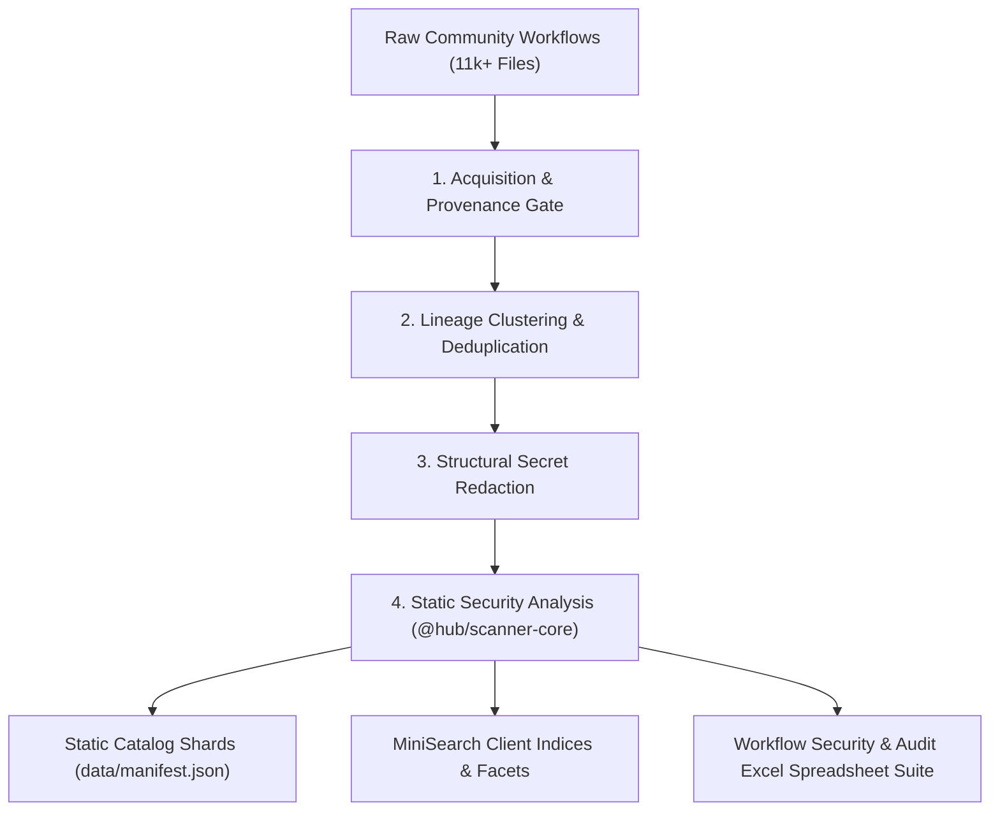

# @hub/pipeline — Workflow Ingestion, Security Auditing & Catalog Pipeline

> **Subsystem Identity:** `@hub/pipeline`  
> **Responsibility:** Offline Corpus Acquisition, Deduplication, Sanitization, Excel Spreadsheet Export, and Static Shard Generation  
> **Licensing:** Pipeline and scanner tooling are MIT; the catalogue dataset has separate Personal / Non-Commercial terms. See [LICENSING.md](../docs/LICENSING.md).

---

## 1. Overview & Purpose

`@hub/pipeline` is the build-time data engineering engine of **n8n-SecureFlow**. It ingests, validates, sanitizes, analyzes, and shards **11,464 public n8n workflows** collected from official n8n template registries and open-source GitHub repositories.

### Invariants & Guarantees
* **Deterministic Execution:** Pipeline stages are pure functions of their inputs plus an explicit frozen clock. Running the pipeline twice on the same input produces byte-identical output.
* **Strict Provenance & Rights:** If a workflow's repository source, commit, author, or license cannot be established, the entry is dropped rather than guessed.
* **Structural Secret Sanitization:** Any accidental credentials, authorization tokens, or private secrets found in public workflows are scrubbed and redacted before publication.

---

## 2. Ingestion & Processing Lifecycle



---

## 3. The Workflow Security & Audit Excel Spreadsheet Suite

As part of our commitment to transparent security research, `@hub/pipeline` processes the entire 11,464 workflow corpus and produces an offline **Workflow Security & Audit Excel Spreadsheet Suite** (`.xlsx`).

### Spreadsheet Features & Schema
The spreadsheet provides security engineers and researchers with a massive, queryable matrix covering the entire open-source n8n ecosystem:
* **Identification & Lineage:** `Entry ID`, `Title`, `Source Repository`, `License`, `Author`, `GitHub Stars`.
* **Structural Topology:** `Node Count`, `Connection Count`, `Trigger Type`, `Subworkflow References`.
* **Security Risk Scoring:** `Overall Security Grade (A-F)`, `Finding Count`, `Critical Vulnerabilities`, `Indeterminate Status`.
* **Vulnerability & CWE Matrix:**
  * Shell Execution & Command Injection (`CWE-78`).
  * Hardcoded Authorization Headers & Secret Tokens (`CWE-798`).
  * SQL Injection Sinks (`CWE-89`).
  * Tainted Server-Side Request Forgery (`CWE-918`).
  * Dynamic Code Execution in Function Nodes (`CWE-95`).
  * OWASP Agentic Prompt Injection & Ungated AI Tools (`CWE-77`, `CWE-269`).
* **Integration Footprint:** Granular column flags indicating connected services (OpenAI, Slack, Google Sheets, Postgres, Telegram, AWS, etc.).

### Use Cases
* **Enterprise Threat Modeling:** Discover how common high-risk nodes (e.g. `Execute Command`) are across thousands of automation templates.
* **Security Auditing & Compliance:** Filter for workflows that improperly embed basic authentication headers or unapproved domains.
* **Offline Dataset Analysis:** Feed the dataset into Python pandas, Excel pivot tables, or internal SIEM dashboards.

---

## 4. Pipeline Stages & Verification

### 4.1 Acquisition & Normalization
* **File:** `pipeline/build-corpus.ts`
* Ingests workflows from primary registries while preserving raw JSON hashes.
* Drops corrupt, truncated, or syntactically invalid files before analysis.

### 4.2 Deduplication & Lineage Clustering
* Analyzes workflow structure, graph topologies, and connection hashes to group duplicate workflows and template variations into canonical clusters.
* Prevents search index spam and deduplicates repeated template forks.

### 4.3 Static Sharding & MiniSearch Generation
* Compiles catalog metadata into compressed JSON shards (`data/packs/`) and binary search indices (`data/search-index.json`).
* Allows the static web application to perform instant multi-facet searches without querying a backend database.

---

## 5. Development & Running the Pipeline

```bash
# Build the pipeline tools
npm run build --workspace=@hub/pipeline

# Run full corpus validation and shard generation
npm run corpus

# Sync built data artifacts to the web application public directory
npm run sync:data
```

---

## 6. Licensing Terms

Pipeline and scanner tooling are MIT-licensed under the repository [`LICENSE`](../LICENSE). See the [canonical licensing policy](../docs/LICENSING.md).
